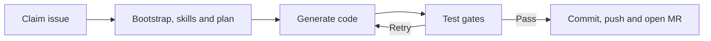
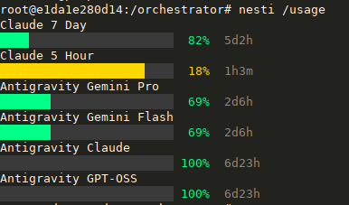

# Nesti — autonomous developer

Nesti turns opted-in GitLab issues into Laravel 13 + PrimeVue 5 Merge Requests.
It plans and generates code through an LLM cascade, then runs the applicable
PHPUnit, OpenAPI, Vitest and Playwright gates in ephemeral Docker sandboxes.

---

## How it works



Provider order: consumer subscriptions → optional local Ollama →
OpenRouter → DeepSeek → Anthropic API. Unavailable providers are skipped;
paid APIs require explicit configuration. See [provider setup](#platform-gateway-apis).

Note: The local LLM tiers are disabled by default because they require dedicated strong GPU/hardware.

Test gates run in order: **PHPUnit → OpenAPI → Vitest → Playwright**.
Changed files, not the declared issue scope, determine which gates run:

- PHP-only: PHPUnit, plus OpenAPI when the API surface changes.
- Frontend-only in a Vue repository: Vitest and Playwright, even in Laravel.
- Both sides (including Blade or `routes/web.php`): backend and frontend
  gates; OpenAPI still depends on API changes.
- Neither side: PHPUnit. Repositories without PHP use the frontend gates.

Redis preserves each issue's conversation and failure output. Failed gates
escalate the coder, with up to `MAX_CODE_RETRIES` extra attempts. Retries remove
stale new files and restore previously edited committed files from `HEAD`.

### Documentation files

Name `README.md`, `CHANGELOG.md` or a `docs/` file in the issue if it should
change; otherwise Nesti leaves it untouched.

---

## Issue Intake (GitLab Issues)

Write the issue in English and add `GITLAB_ISSUE_LABEL` (default `nesti`).
See [ISSUE_GUIDELINE.md](ISSUE_GUIDELINE.md) for short examples and detailed
request guidance. Issue numbers are project-scoped IIDs, such as `#7`.

| State | Condition |
|-------|-----------|
| Pending | Open, opted in, no control label or unresolved dependency record |
| In progress | `<label>::in-progress` |
| Paused | `<label>::pause` or an active dependency record |
| Done | Closed |

Nesti verifies label changes by reading the issue back; a rejected claim
stops before cloning. Success removes the lock and posts the MR URL
(`Closes #<iid>`); exhausted retries remove the lock and post the failure.
Human closures, opt-outs and manual pauses are not reversed. Unresolved or
malformed dependency records block intake; do not bypass them by stripping labels.

---

## Laravel 13 + PrimeVue 5 Role

Database work uses new reversible Schema-builder migrations and Faker-backed
factories/seeders. Existing migrations are never edited, renamed or deleted;
raw DDL, destructive reset commands and table truncation are forbidden.

### Bootstrap node

Before planning, Nesti checks the target repository:

| Repository state | Mode | Behaviour |
|------------------|------|-----------|
| No `artisan`, no `composer.json` | **scaffold** | `composer create-project` + `php artisan install:api` + `composer require dedoc/scramble`, then all templates from `templates/laravel/` |
| `artisan` present | **top-up** | Writes only the missing `vitest.config.js`, `playwright.config.js`, `tests/Feature/OpenApiDocumentationTest.php` + missing `package.json` keys |
| `composer.json` without `artisan` | **refused** | Returns `success=False` — scaffolding over a foreign PHP app would destroy it |

---

## OpenAPI Layer

[Scramble](https://scramble.dedoc.co/) exports `openapi.json`, which is
committed with the change. Nesti compares it with `php artisan route:list
--json` and fails if any `/api` route is missing. `scramble:analyze` is advisory.

This gate runs for changes to `routes/api.php`, `app/Http/Controllers`,
`app/Http/Resources` or `app/Http/Requests`, not pure Vue or migration changes.

---

## Vendored Skill Corpus

[`skills/`](skills/) contains offline PrimeVue 5, Laravel 13 and engineering
practice docs. `skill_catalog.py` selects them by issue wording and aliases;
**no skill URL is needed for bundled documentation**. URLs in the issue are
fetched separately for additional context.

Regenerate `primevue/`, `laravel/` and `registry.json` with
`scripts/fetch_skills.py`; do not hand-edit them. Only `skills/practices/` is
hand-maintained, with provenance and licences included. After editing a practice:

```bash
python scripts/fetch_skills.py --only practices
```

Deploy the updated corpus and restart to index it before polling.

---

## Hierarchical Vector Memory

Semantic retrieval supplements the keyword catalog with:

- **Qdrant:** relevant passages from the bundled documentation.
- **Redis 8:** past solution plans and failed-attempt context; episodes are
  deleted when their issue finishes.

Document retrieval has two stages:

- **BGE + FastEmbed** (`BAAI/bge-small-en-v1.5`, 384 dimensions) embeds
  documents and queries on the CPU; Qdrant finds candidate passages.
- **Ettin + PyTorch** (`cross-encoder/ettin-reranker-150m-v1`) scores
  query–passage pairs in that small candidate pool to select more relevant
  passages. It reranks retrieval results rather than replacing the embedder.

Runtime memory failures degrade to no results. Disable retrieval with
`NESTI_MEMORY_ENABLED=false`.

Startup indexes changed documents before polling; indexing failure stops
startup. Changing the embedding model requires
`python scripts/index_skills.py --recreate` and matching vector dimensions.

---

## Frontend Testing

| Layer | Sandbox image | Runtime |
|-------|---------------|---------|
| PHPUnit | `nesti-sandbox-php` | PHP 8.3 + Composer |
| Vitest + Vue Test Utils | `nesti-sandbox-node` | Node 22 |
| Playwright | `nesti-sandbox-e2e` | Playwright 1.50.0 + Node 22 + PHP 8.3 |

Keep `@playwright/test` pinned exactly to the E2E image version.
Exclude `e2e/**` from Vitest so it does not collect Playwright specs.

Laravel E2E runs use `APP_ENV=testing` and a recreated workspace SQLite
database. Migrations, default seeding and declared fixtures run before the
build and browser tests, regardless of issue scope. Fixture models pointing
to another database are refused.

### Served-page integration

Verify the actual route → Blade → Vite → Vue entry chain, not just an isolated
component. Preserve PrimeVue/Aura/plugins and the existing root architecture;
register before mount and use explicit kebab-case closing tags in Blade.

## Fixture dependencies

An optional committed `e2e/nesti-fixtures.json` declares a hard nonempty
real-data prerequisite for an existing unauthenticated GET collection:

```json
{"version":1,"fixtures":[{"endpoint":"/api/tasks","model":"App\\Models\\Task","seeder":"Database\\Seeders\\TaskSeeder"}]}
```

Use the manifest only for hard nonempty prerequisites, not valid empty states,
mocks or specs that create their own data through existing UI/API routes.
It accepts up to 16 unique requirements in 32 KiB, with exact fields and local
`/api/...` paths. Retries must re-emit required fixtures or emit `fixtures: []`.

After default seeding, the helper checks the endpoint. If already nonempty,
it does nothing; otherwise it verifies an empty backing table and runs the
declared seeder once. This does not modify production `DatabaseSeeder`.

Only a missing seeder class **and** conventional PHP file can produce exit 78
with the matching `/nesti-results/fixtures.json` report: `Playwright BLOCKED`.
Timeouts, HTTP/auth/JSON errors, unverified model mappings, filtered-out rows
and broken or ineffective seeders remain failures, not dependency requests.

For an unchanged HEAD-backed API/model with no coder-authored backend changes,
Nesti records intent, verifies the pause and opens one backend dependency.
Declare a missing `<Model>Seeder` in JSON without creating or registering it
in the frontend parent. New backend work must include its own factory/seeder.

Trusted GitLab notes (`NESTI_FIXTURE_DEPENDENCIES_V1` and child ownership
`NESTI_FIXTURE_CHILD_V1`), not Redis, bind the dependency to its project,
parent, target branch and fixture. Foreign, malformed or stale records cannot
release a parent.

Polling reconciles dependencies before selecting work. Release requires all
related MRs to start with `Closes #<child>` and be verified merged into the
recorded project/target; closing a child or opening an MR is insufficient.
The parent makes no LLM calls or retries while waiting. Reconciliation
preserves later locks/manual pauses. A merged but still-unsatisfied fixture
requires operator recovery, not a second child.

### Operator recovery

Stop the poller first (`docker-compose stop nesti-orchestrator`), restore
GitLab access and use the same automation identity. Notes, labels, issue
creation and related/detail MR reads must be permitted. A new token for the
same user is safe; changing users requires explicit migration of trusted
notes/child ownership, never a silent trust fallback.

- **Unknown child POST outcome:** enumerate all issues, including closed and
  unlabelled, and check trusted exact-key ownership markers. Reconcile one
  found child. Only after establishing no request remains in flight and no
  child exists may an operator read `get_fixture_state`, reset that item's
  `creation_submitted=false`, `state="creating"`, `reason=""`, and write it
  with `save_fixture_state`. The next poll makes one POST; elapsed time alone
  is not evidence that creation failed.
- **Blocked existing child corrected by a later MR:** explicitly set its
  item to `waiting` and clear its reason through the verified state methods.
  Normal MR merge verification still applies. Ambiguous ownership must be
  resolved before changing state.
- **Pause/stale lock with no durable record:** verify no child or open/merged
  closing MR exists, then use `resume_issue` and clear only that parent's
  conversation and episodes. Ordinary crash recovery refuses the hold;
  reconciliation cannot reconstruct evidence never saved.
- **Configured target changed:** keep the hold and explicitly migrate the
  record after reviewing the target/MR. Do not manually strip labels to
  bypass a durable record.

Use a one-off application container with `--entrypoint python` while the
poller is stopped; dependency mutations are deliberately not exposed by MCP.
Restart only after independently verifying the intended note and labels.


---

## Architecture

| Area | Entry points |
|------|--------------|
| Orchestration | `main.py`, `task_engine.py`, `graph/` (LangGraph) |
| Providers and prompts | `llm_client.py`, `prompt_builder.py`, `issue_scope.py` |
| GitLab and dependencies | `gitlab_issues_client.py`, `gitlab_client.py`, `issue_dependencies.py` |
| Sandboxes and fixtures | `docker_runner.py`, `frontend_runner.py`, `e2e_fixtures.py` |
| Context and memory | `skill_catalog.py`, `skill_loader.py`, `conversation_store.py`, `vector_store.py`, `semantic_cache.py` |
| Interactive tools | `mcp_server/` (FastMCP), `scripts/oauth.py` (`nesti` CLI) |
| Usage statistics | `stats/` (`nesti /stats` → `state/stats.html`) |

[`docker-compose.yml`](docker-compose.yml) runs the orchestrator, MCP server,
Redis and Qdrant; sandbox containers are created per test run and removed
afterwards. Dependencies and image versions live in
[`requirements.txt`](requirements.txt) and the Dockerfiles.

---

## Installation

Configure `.env`, then start:
```bash
cp .env.example .env
# Set GitLab access and an API key or consumer subscription.
docker-compose up -d --build
```
Sandbox images are built and skills indexed automatically before polling.

Optional corpus refresh (container-local; indexed on the next restart):
```bash
docker exec nesti-orchestrator python scripts/fetch_skills.py
```
A rebuild uses the repository's corpus, not the container-local refresh.

Optional preflight (creates and closes a GitLab probe issue):
```bash
docker exec nesti-orchestrator python scripts/preflight.py
```

---

## MCP Server

`nesti-mcp` exposes the shared issue, GitLab, sandbox, skill, memory and quota
tools over stdio. It runs alongside the orchestrator and makes no LLM calls.

Connect Claude Code:

```bash
claude mcp add nesti docker exec -i nesti-mcp python -m mcp_server.server
```

For VS Code, use [`.vscode/mcp.json.example`](.vscode/mcp.json.example).
Other MCP clients can use the same `docker exec -i` command.
Dependency mutations remain internal to the orchestrator to preserve a single
polling writer.

---

## Platform Gateway APIs
Run the CLI inside the orchestrator:

```bash
docker exec -it nesti-orchestrator nesti /provider
docker exec -it nesti-orchestrator nesti /provider login claude
docker exec -it nesti-orchestrator nesti /usage
```

Available commands (prefix each with `nesti` inside the container):

| Command | Purpose |
|---------|---------|
| `/provider` | List consumer and platform providers |
| `/provider login <name>` / `/provider logout <name>` | Add or remove a consumer session |
| `/provider models <name> [search]` | List text models and prices per million tokens |
| `/provider model <name> [model-id\|--reset]` | View, persist or reset model selection (OpenRouter) |
| `/usage` | Show authenticated consumer usage and quota |
| `/stats` | Usage statistics page: requests, tokens, API-equivalent cost and errors per project, model and provider |

OpenRouter needs an explicit model via `OPENROUTER_MODEL` or
`nesti /provider model openrouter <model-id>`.

## Consumer Subscriptions & Quota

Supported login names: `claude`, `antigravity`, `chatgpt-plus`, `copilot`.
Consumer login/logout takes effect on the next inference call without restart.
Copilot's current PAT login supports quota reporting, not inference.

`/usage` shows a used-capacity bar, remaining percentage and reset countdown.



*Example output; quota values and reset times vary by account and usage.*

Missing quota is unknown, not estimated; Copilot reports usage without a
remaining figure. ChatGPT Plus uses the Codex backend; its quota endpoint is
internal and may change. Credentials are renewed and persisted automatically.
On test failures, Nesti checks quota and sends low-capacity Telegram warnings
when configured.

---

## Configuration

Use [`.env.example`](.env.example) as the configuration reference:

- Required: `GITLAB_URL`, `GITLAB_TOKEN`, `GITLAB_PROJECT_PATH` and at least
  one usable LLM provider.
- `NESTI_CONSUMER_PRIORITY` orders subscriptions.
- Paid APIs require both their `*_API_ENABLED=true` flag and API key.
  A disabled flag prevents billing even when a key is present; Anthropic's
  API flag does not disable the Claude consumer subscription.
- Retry, sandbox timeout, memory, model and optional Telegram settings are
  listed in `.env.example`. Recreate containers after editing `.env`;
  existing processes do not reload it.

---

## Verification

**Offline smoke tests** (no Docker, no network):
```bash
python test_graph_smoke.py
```

**Live integration tests** (needs Docker + network):
```bash
python test_live_laravel.py
```

---

## License

MIT
