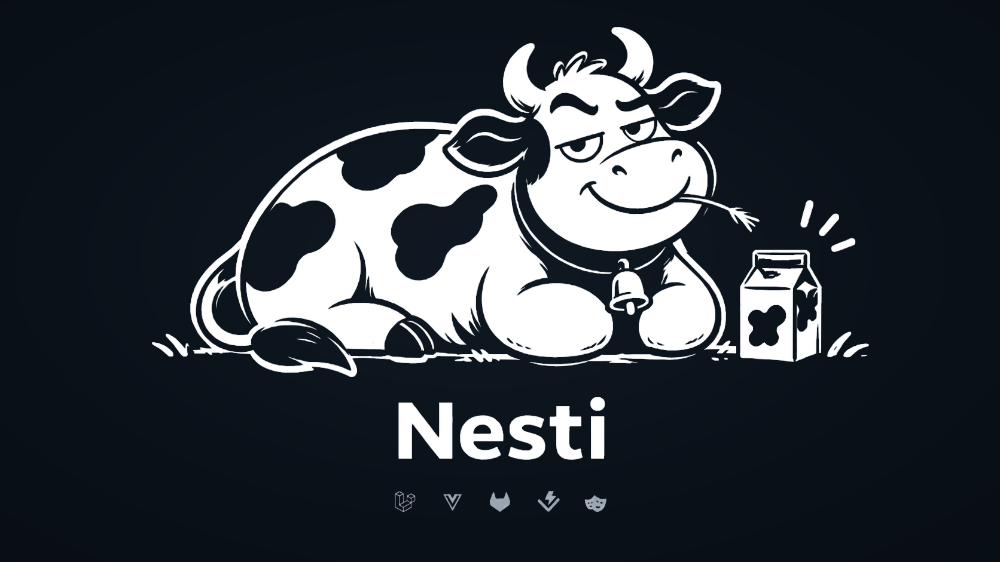
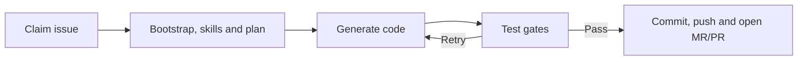
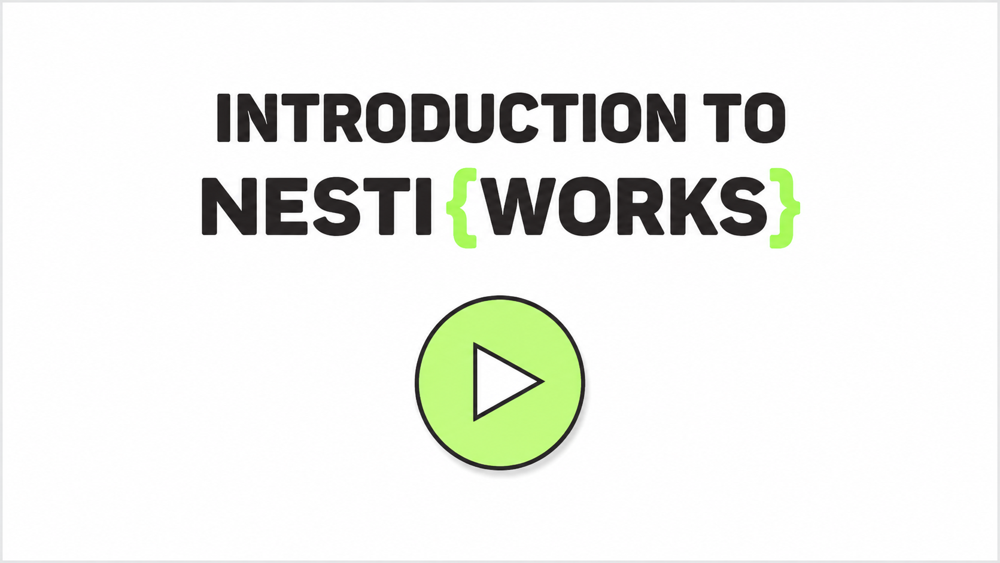
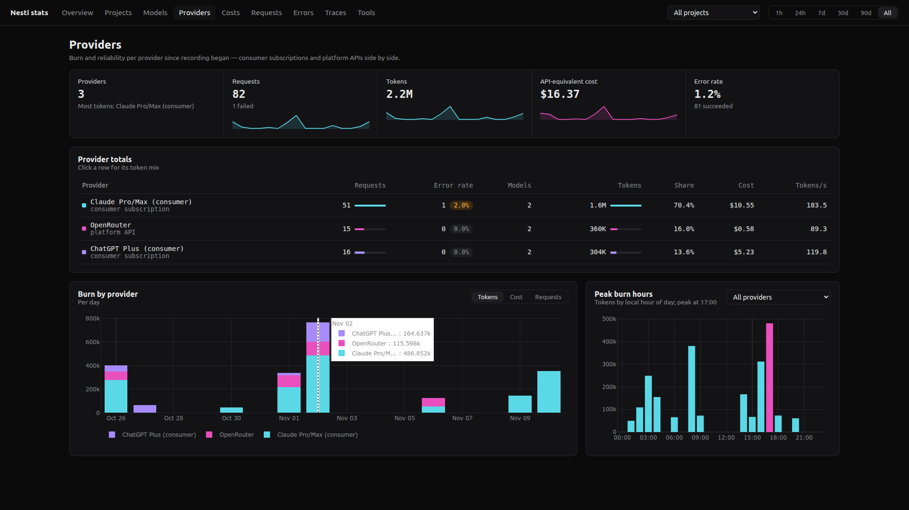
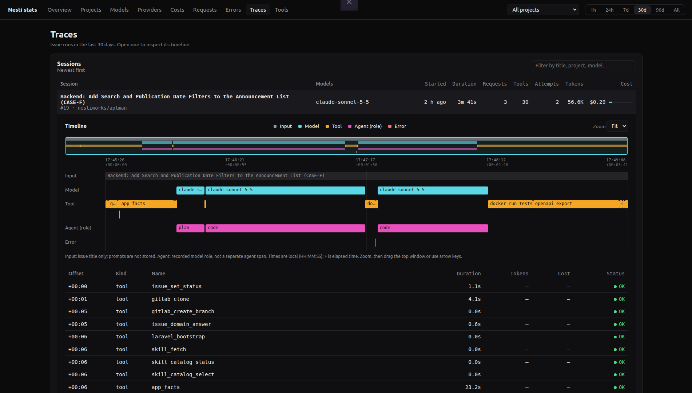
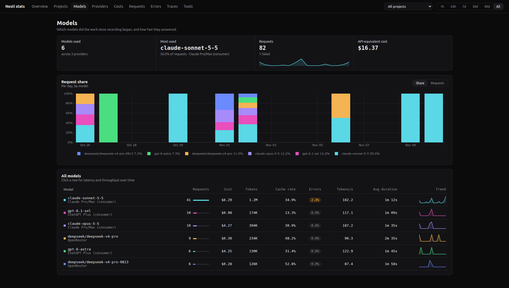
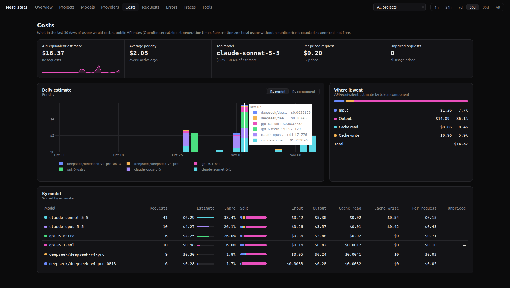
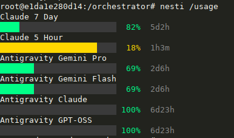

<p align="center">
  
</p>

<p align="center">
  <em>For those who keep a cow in the next room for just one carton of milk.</em>
</p>

---


Nesti turns opted-in GitLab or GitHub issues into Laravel 13 + PrimeVue 5
Merge Requests or Pull Requests.
It plans and generates code through an LLM cascade, then runs the applicable
PHPUnit, OpenAPI, Vitest and Playwright gates in ephemeral Docker sandboxes.

---

## How it works



Provider order: consumer subscriptions → optional local Ollama →
OpenRouter → DeepSeek → Anthropic API. Unavailable providers are skipped;
paid APIs require explicit configuration. See [provider setup](#platform-gateway-apis).

Note: The local LLM tiers are disabled by default because they require dedicated strong GPU/hardware.

Test gates run in order: **PHPUnit → OpenAPI → Vitest → Playwright**.
Changed files, not the declared issue scope, determine which gates run:

- Backend folder only: PHPUnit, plus OpenAPI when the API surface changes.
- SPA folder only: Vitest and Playwright.
- Both folders: backend and frontend gates; OpenAPI still depends on API changes.
- Neither folder: PHPUnit.

Redis preserves each issue's conversation and failure output. Failed gates
escalate the coder, with up to `MAX_CODE_RETRIES` extra attempts. Retries remove
stale new files and restore previously edited committed files from `HEAD`.

### Documentation files

Name `README.md`, `CHANGELOG.md` or a `docs/` file in the issue if it should
change; otherwise Nesti leaves it untouched.

---

<p>
  <a href="https://www.youtube.com/watch?v=ua7AfRvcorw">
    
  </a>
</p>

Use Nesti on its own, or pair it with the [nestiworks](https://github.com/samettemizer/nestiworks/tree/main/laravel) plugin to take on escalated tasks.

---

## Issue Intake (GitLab or GitHub Issues)

Write the issue in English and add the opt-in label (`GITLAB_ISSUE_LABEL`, or
`NESTI_GITHUB_ISSUE_LABEL` on GitHub; default `nesti`).
See [ISSUE_GUIDELINE.md](ISSUE_GUIDELINE.md) for short examples and detailed
request guidance. Issue numbers are project-scoped IIDs, such as `#7`.

| State | Condition |
|-------|-----------|
| Pending | Open, opted in, no control label, no failed-run marker |
| In progress | `<label>::in-progress` |
| Paused | `<label>::pause` |
| Done | Closed |

Nesti verifies label changes by reading the issue back; a rejected claim
stops before cloning. Success removes the lock and posts the MR/PR URL
(`Closes #<iid>`); exhausted retries remove the lock and post the failure.
Human closures, opt-outs and manual pauses are not reversed.

---

## Laravel 13 + PrimeVue 5 Role

Nesti works on projects whose frontend is a separate SPA and whose Laravel backend serves only an API. We do not recommend it for existing websites whose frontend lives inside the Laravel application (Blade pages, Inertia, Livewire, or Vue/React under resources/): Nesti refuses such a project at startup and never scaffolds one.

Database work uses new reversible Schema-builder migrations and Faker-backed
factories/seeders. Existing migrations are never edited, renamed or deleted;
raw DDL, destructive reset commands and table truncation are forbidden.

### Bootstrap node

Before planning, Nesti checks the target repository:

| Repository state | Mode | Behaviour |
|------------------|------|-----------|
| No `artisan`, no `composer.json` | **scaffold** | API-only Laravel in `webservice/`: `composer create-project` + `php artisan install:api` + `composer require dedoc/scramble`, then all templates from `templates/laravel/`; a starter SPA when the issue asks for UI |
| `artisan` present | **top-up** | Backend: only a missing `tests/Feature/OpenApiDocumentationTest.php`. SPA: only the missing `vitest.config.js`, `vitest.setup.js`, `playwright.config.js` + missing `package.json` keys; an unmodified earlier Nesti `vitest.config.js` is upgraded in place |
| `composer.json` without `artisan` | **refused** | Returns `success=False` — scaffolding over a foreign PHP app would destroy it |

---

## OpenAPI Layer

[Scramble](https://scramble.dedoc.co/) exports `openapi.json`, which is
committed with the change. Nesti compares it with `php artisan route:list
--json` and fails if any `/api` route is missing. `scramble:analyze` is advisory.

This gate runs for changes to `routes/api.php`, `app/Http/Controllers`,
`app/Http/Resources` or `app/Http/Requests`, not pure Vue or migration changes.

---

## Vendored Skill Corpus

[`skills/`](skills/) contains offline PrimeVue 5, Laravel 13 and engineering
practice docs. `skill_catalog.py` selects them by issue wording and aliases;
**no skill URL is needed for bundled documentation**. URLs in the issue are
fetched separately for additional context.

Regenerate `primevue/`, `laravel/` and `registry.json` with
`scripts/fetch_skills.py`; do not hand-edit them. Only `skills/practices/` is
hand-maintained, with provenance and licences included. After editing a practice:

```bash
python scripts/fetch_skills.py --only practices
```

Deploy the updated corpus and restart to index it before polling.

---

## Hierarchical Vector Memory

Semantic retrieval supplements the keyword catalog with:

- **Qdrant:** relevant passages from the bundled documentation.
- **Redis 8:** past solution plans and failed-attempt context; episodes are
  deleted when their issue finishes.

Document retrieval has two stages:

- **BGE + FastEmbed** (`BAAI/bge-small-en-v1.5`, 384 dimensions) embeds
  documents and queries on the CPU; Qdrant finds candidate passages.
- **Ettin + PyTorch** (`cross-encoder/ettin-reranker-150m-v1`) scores
  query–passage pairs in that small candidate pool to select more relevant
  passages. It reranks retrieval results rather than replacing the embedder.

Runtime memory failures degrade to no results. Disable retrieval with
`NESTI_MEMORY_ENABLED=false`.

Startup indexes changed documents before polling; indexing failure stops
startup. Changing the embedding model requires
`python scripts/index_skills.py --recreate` and matching vector dimensions.

---

## Frontend Testing

| Layer | Sandbox image | Runtime |
|-------|---------------|---------|
| PHPUnit | `nesti-sandbox-php` | PHP 8.4 + Composer |
| Vitest + Vue Test Utils | `nesti-sandbox-node` | Node 22 |
| Playwright | `nesti-sandbox-e2e` | Playwright 1.50.0 + Node 22 (no PHP) |

Keep `@playwright/test` pinned exactly to the E2E image version.
Exclude `e2e/**` from Vitest so it does not collect Playwright specs.

`vitest.setup.js` polyfills `matchMedia` and `ResizeObserver`, which PrimeVue
needs under jsdom.

Playwright builds the SPA and serves it with `vite preview`; the Laravel API is
not running. Specs sign in and stub every API request through
`e2e/support/session.(js|ts)` (`signIn`, `stubApi`); an unstubbed request gets
a logged 404.


---

## Architecture

| Area | Entry points |
|------|--------------|
| Orchestration | `main.py`, `task_engine.py`, `graph/` (LangGraph) |
| Providers and prompts | `llm_client.py`, `prompt_builder.py`, `issue_scope.py` |
| Forge | `forge.py`, `gitlab_issues_client.py`, `gitlab_client.py`, `github_issues_client.py`, `github_client.py`, `git_auth.py` |
| Sandboxes | `docker_runner.py`, `frontend_runner.py` |
| Context and memory | `skill_catalog.py`, `skill_loader.py`, `conversation_store.py`, `vector_store.py`, `semantic_cache.py` |
| Interactive tools | `mcp_server/` (FastMCP), `scripts/oauth.py` (`nesti` CLI) |
| Usage statistics | `stats/` (`nesti /stats` → live page `http://127.0.0.1:8790`) |

[`docker-compose.yml`](docker-compose.yml) runs the orchestrator, MCP server,
the `nesti-stats` page server, Redis and Qdrant; sandbox containers are created per test run and removed
afterwards. Dependencies and image versions live in
[`requirements.txt`](requirements.txt) and the Dockerfiles.

---

## Installation

### install.sh

The setup wizard checks the prerequisites (docker, git, curl, Python 3, Docker
Compose), asks for the forge (`NESTI_FORGE`: `gitlab`, the default, or
`github`), writes `.env` from prompts, verifies forge access, creates the
opt-in labels if missing, clones the project checkout when absent, builds and starts the
containers, waits for readiness, offers consumer provider logins, installs the
`nesti` launcher to `~/.local/bin` and optionally runs the preflight:
```bash
./install.sh            # interactive
```
`--help` lists the options.

### GitHub

Set `NESTI_FORGE=github` (install.sh asks) and configure the
`NESTI_GITHUB_*` block of `.env.example`:

- Run Nesti as a **dedicated bot account**, never a maintainer's personal
  account: with a personal token your own replies count as Nesti's notes.
  install.sh shows the token owner and asks for confirmation.
- Token: a fine-grained PAT restricted to the one repository with Contents
  RW, Issues RW, Pull requests RW and Metadata R. Variables RW is optional and
  enables the poll heartbeat that detects a second poller; without it that
  check is skipped and a warning is logged on every poll.
- Adding the opt-in label needs triage permission. install.sh creates
  `<label>`, `<label>::in-progress` and `<label>::pause` when missing.
- Only issues authored by repository owners, members or collaborators are
  picked up ([ISSUE_GUIDELINE.md](ISSUE_GUIDELINE.md#on-github)). The issue
  closes when the Pull Request opens.
- Rollback: set `NESTI_FORGE=gitlab` and recreate the containers.

### Manual Installation

Configure `.env`, then start:
```bash
cp .env.example .env
# Set forge access (GitLab, or NESTI_FORGE=github) and an API key or consumer subscription.
docker-compose up -d --build
```
Sandbox images are built and skills indexed automatically before polling.

Optional corpus refresh (container-local; indexed on the next restart):
```bash
docker exec nesti-orchestrator python scripts/fetch_skills.py
```
A rebuild uses the repository's corpus, not the container-local refresh.

Optional preflight (creates and closes a probe issue on the forge):
```bash
docker exec nesti-orchestrator python scripts/preflight.py
```

---

## MCP Server

`nesti-mcp` exposes the shared issue, forge, sandbox, skill, memory, quota and usage statistics
tools over stdio. It runs alongside the orchestrator and makes no LLM calls.

Connect Claude Code:

```bash
claude mcp add nesti -- nesti mcp
```

For VS Code, use [`.vscode/mcp.json.example`](.vscode/mcp.json.example).
Other MCP clients run `nesti mcp` from the project's git checkout, or `nesti mcp <checkout>`:
each connection acts on the GitLab project or GitHub repository of that checkout's `origin` remote.

---

## Platform Gateway APIs
Run the CLI inside the nesti-orchestrator container:

```bash
nesti /provider
nesti /provider login claude
nesti /usage
```

Available commands (prefix each with `nesti` inside the container):

| Command | Purpose |
|---------|---------|
| `/provider` | List consumer and platform providers |
| `/provider login <name>` / `/provider logout <name>` | Add or remove a consumer session |
| `/provider models <name> [search]` | List text models and prices per million tokens |
| `/provider model <name> [model-id\|--reset]` | View, persist or reset model selection (OpenRouter) |
| `/usage` | Show authenticated consumer usage and quota |
| `/stats` | Usage statistics page at `http://127.0.0.1:8790/` (`nesti-stats` service): requests, tokens, API-equivalent cost and errors per project, model and provider. A refresh shows current data; the selected range and project are kept |
| `/arch [--json]` | Static architecture page `state/architecture.html`; `--json` prints the layout record instead |

OpenRouter needs an explicit model via `OPENROUTER_MODEL` or
`nesti /provider model openrouter <model-id>`.

## Statistics

`nesti /stats` prints the local page URL; the `nesti-stats` service serves it.

<table>
  <tr>
    <td width="50%" valign="top">
      
      <br /><sub><b>Providers</b> — recorded provider and model usage, all retained activity</sub>
    </td>
    <td width="50%" valign="top">
      
      <br /><sub><b>Traces</b> — issue-run timeline, duration and estimated cost</sub>
    </td>
  </tr>
  <tr>
    <td width="50%" valign="top">
      
      <br /><sub><b>Models</b> — which models did the work and how fast they answered.</sub>
    </td>
    <td width="50%" valign="top">
      
      <br /><sub><b>Costs</b> — usage priced at public API rates.</sub>
    </td>
  </tr>
</table>

*Illustrative live snapshot; totals vary. Costs are API-equivalent estimates, not
subscription bills, and an unpriced model is not proof of zero cost.*

## Consumer Subscriptions & Quota

Supported login names: `claude`, `antigravity`, `chatgpt-plus`, `copilot`.
Consumer login/logout takes effect on the next inference call without restart.
Copilot's current PAT login supports quota reporting, not inference.

`/usage` shows a used-capacity bar, remaining percentage and reset countdown.



*Example output; quota values and reset times vary by account and usage.*

Missing quota is unknown, not estimated; Copilot reports usage without a
remaining figure. ChatGPT Plus uses the Codex backend; its quota endpoint is
internal and may change. Credentials are renewed and persisted automatically.
On test failures, Nesti checks quota and sends low-capacity Telegram warnings
when configured.

---

## Configuration

Use [`.env.example`](.env.example) as the configuration reference:

- Required: `GITLAB_URL`, `GITLAB_TOKEN`, `GITLAB_PROJECT_PATH` (with
  `NESTI_FORGE=github`: `NESTI_GITHUB_REPOSITORY`, `NESTI_GITHUB_TOKEN`) and
  at least one usable LLM provider.
- `NESTI_CONSUMER_PRIORITY` orders subscriptions.
- Paid APIs require both their `*_API_ENABLED=true` flag and API key.
  A disabled flag prevents billing even when a key is present; Anthropic's
  API flag does not disable the Claude consumer subscription.
- Retry, sandbox timeout, memory, model and optional Telegram settings are
  listed in `.env.example`. Recreate containers after editing `.env`;
  existing processes do not reload it.

---

## Verification

**Offline smoke tests** (no Docker, no network):
```bash
python test_graph_smoke.py
```

**Live integration tests** (needs Docker + network):
```bash
python test_live_laravel.py
```

---

## License

MIT
